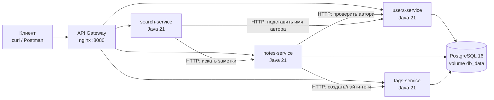

# NotesPlatform — сервис заметок на Java

Финальный проект по дисциплине «Введение в DevSecOps». Тема — сервис заметок, та самая, что была зафиксирована в начале курса. Реализация — четыре микросервиса на Java 21 / Spring Boot, PostgreSQL и Docker Compose.

Идея: пользователь регистрируется, пишет заметки и размечает их тегами. Обычного CRUD было бы мало, поэтому добавился сервис поиска: он ищет по тексту заметок, умеет фильтровать по автору и тегу и показывает фасеты — сколько раз какой тег встретился в результатах. Это и есть развитие темы: поиск собирает данные сразу из двух сервисов по HTTP.

Всё работает локально, без внешних сайтов и API-ключей. Никаких капч и случайных ошибок.

## Архитектура

C4-схема: `docs/architecture.drawio` (Context, Container, Component) и экспорт `docs/architecture.png`.



Взаимодействие только по HTTP внутри docker-сети `app_net`. У каждого сервиса своя таблица: `users`, `notes` + `note_tags`, `tags`. Общая база одна, но владелец у таблицы ровно один — так проще объяснять границы сервисов на защите.

## Сервисы

| Сервис | Папка | Ответственность | API | Таблица |
|---|---|---|---|---|
| gateway | `gateway/` | nginx, единая точка входа `:8080`, маршрутизация `/users/`, `/notes/`, `/tags/`, `/search/` | проксирование | — |
| users-service | `users-service/` | регистрация и профили | `POST /users`, `GET /users`, `GET /users/{id}`, `GET /health` | `users` |
| tags-service | `tags-service/` | реестр тегов, нормализация имён, счётчик использования | `POST /resolve`, `GET /tags`, `GET /tags/{id}`, `GET /health` | `tags` |
| notes-service | `notes-service/` | CRUD заметок, связь с тегами, поиск по тексту | `POST /notes`, `GET /notes`, `GET /notes/{id}`, `GET /notes/search`, `PUT /notes/{id}`, `DELETE /notes/{id}`, `GET /health` | `notes`, `note_tags` |
| search-service | `search-service/` | поиск через notes-service, обогащение авторством, фасеты по тегам | `POST /search`, `GET /health` | — |
| db | — | PostgreSQL 16, база `app`, данные в volume `db_data` | — | все таблицы |

При создании заметки `notes-service` сначала вызывает `GET users-service/users/{id}` — проверяет, что автор существует, — затем `POST tags-service/resolve`, чтобы получить id тегов. Теги нормализуются в нижний регистр и дедуплицируются. Поиск идёт через `search-service`: он запрашивает `GET notes-service/notes/search`, а для каждого найденного автора — `GET users-service/users/{id}`.

Все поля JSON в снейк-кейсе: `user_id`, `created_at`, `usage_count` и так далее.

## Технологии

Java 21, Spring Boot 3.3 (Web + JDBC), PostgreSQL 16, Docker, Docker Compose, nginx, curl/Postman, draw.io для C4.

## Запуск

Нужны Docker Desktop или Docker Engine с Compose v2. Локальный Java и Maven не нужны — они внутри образа сборки.

```bash
docker compose up --build
```

Приложение доступно на `http://localhost:8080`. Там же открывается минимальная HTML-страница — три блока: пользователь, заметка, поиск. Кнопки ходят в тот же API, что и curl, а снизу печатается код ответа и JSON.

Всё завершается одной командой:

```bash
docker compose down
```

Проверка, что всё поднялось:

```bash
docker compose ps
curl http://localhost:8080/users/health
curl http://localhost:8080/notes/health
curl http://localhost:8080/tags/health
curl http://localhost:8080/search/health
```

Логи (в том числе вызовы между сервисами):

```bash
docker compose logs
docker compose logs notes
```

## Минимальный сценарий

Автоматически: `powershell -ExecutionPolicy Bypass -File scripts/check.ps1`.

### 1. Создаём пользователя

```bash
curl -X POST http://localhost:8080/users/users -H "Content-Type: application/json" -d '{"username":"alice"}'
# {"id":1,"username":"alice",...}
```

### 2. Создаём заметки с тегами

```bash
curl -X POST http://localhost:8080/notes/notes -H "Content-Type: application/json" \
  -d '{"user_id":1,"title":"Docker basics","content":"Containers, volumes, compose","tags":["DevOps","Study"]}'
# {"id":1,...,"tags":[{"id":1,"name":"devops"},{"id":2,"name":"study"}]}
```

Здесь сразу два межсервисных вызова: проверка пользователя и резолвинг тегов.

### 3. Читаем заметку и список

```bash
curl http://localhost:8080/notes/notes/1
curl "http://localhost:8080/notes/notes?user_id=1"
```

### 4. Ищем через search-service

```bash
curl -X POST http://localhost:8080/search/search -H "Content-Type: application/json" \
  -d '{"query":"docker","user_id":1,"tag":null}'
```

В ответе `total`, каждая заметка с именем автора и тегами, плюс фасеты: сколько раз какой тег встретился.

```bash
curl -X POST http://localhost:8080/search/search -H "Content-Type: application/json" \
  -d '{"query":null,"user_id":null,"tag":"study"}'
```

### 5. Статистика тегов и обновление

```bash
curl http://localhost:8080/tags/tags
curl -X PUT http://localhost:8080/notes/notes/1 -H "Content-Type: application/json" \
  -d '{"title":"Docker basics v2","content":"Updated text","tags":["devops","postgres"]}'
```

### 6. Ошибки

```bash
# дубликат пользователя -> 409
curl -X POST http://localhost:8080/users/users -H "Content-Type: application/json" -d '{"username":"alice"}'
# заметка от несуществующего пользователя -> 404
curl -X POST http://localhost:8080/notes/notes -H "Content-Type: application/json" \
  -d '{"user_id":999,"title":"x","content":"y"}'
```

## Сохранение данных

```bash
docker compose restart db
curl http://localhost:8080/notes/notes/1
```

Заметка остаётся на месте: данные в volume `db_data`. Полная очистка — `docker compose down -v`.

## Конфигурация

Ничего не захардкодено: строки подключения и адреса сервисов приходят через environment в `docker-compose.yml` — `SPRING_DATASOURCE_URL`, `SPRING_DATASOURCE_USERNAME`, `SPRING_DATASOURCE_PASSWORD`, `USERS_SERVICE_URL`, `TAGS_SERVICE_URL`, `NOTES_SERVICE_URL`. Пароль и имя базы тоже задаются через `POSTGRES_*`.

## Структура репозитория

```
docker-compose.yml
gateway/          nginx.conf + index.html + Dockerfile
users-service/    Program на Spring Boot, Dockerfile, schema.sql
notes-service/
tags-service/
search-service/
scripts/check.ps1       прогон сценария
docs/                   C4-схема, PNG и выводы проверок
```
